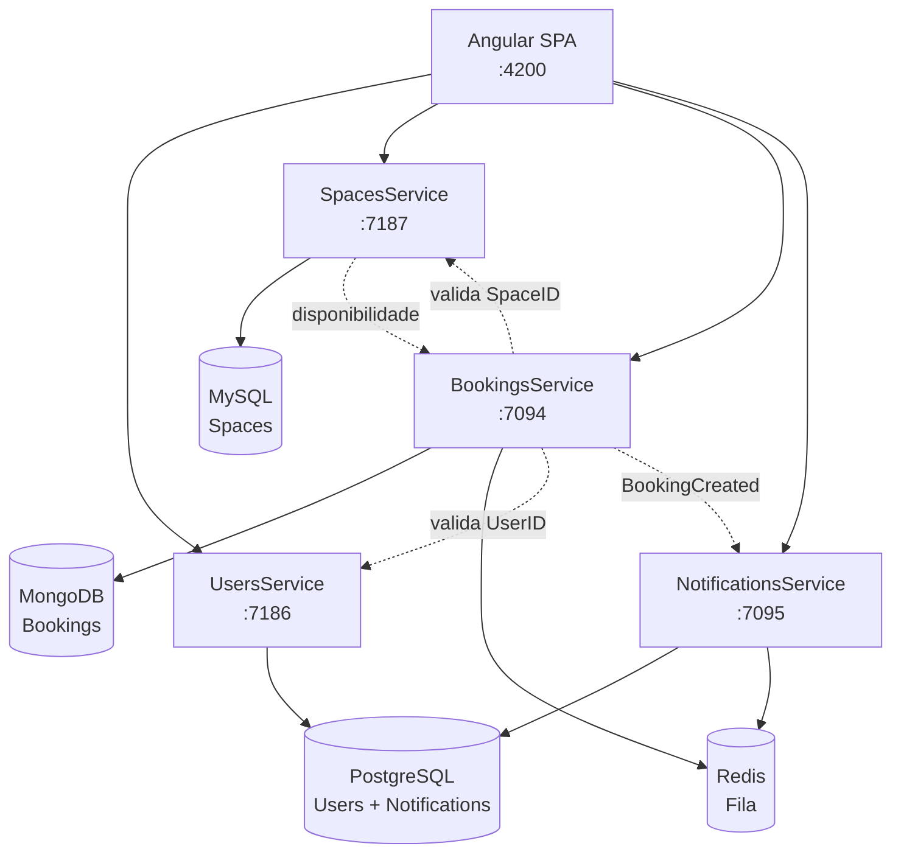

# Plataforma de Reservas

Microsserviços para reserva de espaços (coworking, salas, quartos) com validação de usuário/espaço, controle de conflito de datas e notificações assíncronas via Redis.

## Arquitetura



### Camadas por serviço

Cada API segue o padrão **API → BLL → DAL**:

| Serviço | Banco | Responsabilidade |
|---------|-------|------------------|
| **UsersService** | PostgreSQL (`ReservasUsers`) | Cadastro, login JWT, perfil de usuário |
| **SpacesService** | MySQL (`spaces_db`) | CRUD de espaços e consulta de disponibilidade |
| **BookingsService** | MongoDB (`ReservasBookings`) + Redis | Reservas, validação HTTP com Users/Spaces, publicação de eventos |
| **NotificationsService** | PostgreSQL (`ReservasNotifications`) + Redis | Consumo da fila `booking-events` e histórico de notificações |

### Fluxo de criação de reserva

1. Cliente autenticado chama `POST /api/bookings` no **BookingsService**.
2. BookingsService valida `userId` e `spaceId` via HTTP nos serviços Users e Spaces.
3. Verifica conflito de datas no MongoDB.
4. Persiste a reserva e publica evento `BookingCreated` na fila Redis `booking-events`.
5. **NotificationsService** consome o evento, grava a notificação no PostgreSQL e disponibiliza via API.

---

## Como executar

A forma mais simples é subir **tudo** (bancos, APIs e o frontend Angular) com Docker Compose, na raiz do repositório.

### Pré-requisitos

- [Docker Desktop](https://www.docker.com/products/docker-desktop/) (ou Docker Engine + Compose v2)

### Subir a plataforma completa

Na pasta raiz do projeto (`Reservation MicroService`):

```bash
docker compose up --build
```

Para rodar em segundo plano:

```bash
docker compose up --build -d
```

Quando os containers estiverem prontos:

| Recurso | URL |
|---------|-----|
| **Aplicação (frontend)** | http://localhost:4200 |
| Users Swagger | http://localhost:7186/swagger |
| Spaces Swagger | http://localhost:7187/swagger |
| Bookings Swagger | http://localhost:7094/swagger |
| Notifications Swagger | http://localhost:7095/swagger |

O primeiro acesso já tem catálogo de espaços e um usuário admin (veja [Seed](#seed-e-usuário-admin)).

### Parar

```bash
docker compose down
```

Para apagar dados persistidos (bancos, filas):

```bash
docker compose down -v
```

---

## Executar localmente (dotnet + npm)

Útil para desenvolver. Os bancos continuam no Docker; as APIs e o Angular rodam na máquina.

### Pré-requisitos

- [.NET 8 SDK](https://dotnet.microsoft.com/download)
- [Node.js 20+](https://nodejs.org/) e npm
- Docker para a infraestrutura

### 1. Infraestrutura

```bash
docker compose up -d postgres mysql mongodb redis postgres-init
```

O serviço `postgres-init` cria os bancos `ReservasUsers` e `ReservasNotifications` na primeira execução.

### 2. APIs (.NET)

Cada serviço possui a própria solution. Em terminais separados, a partir da raiz do repositório:

```bash
# Users — http://localhost:7186
cd Users/API
dotnet run --launch-profile http

# Spaces — http://localhost:7187
cd Spaces/API
dotnet run --launch-profile http

# Bookings — http://localhost:7094
cd Bookings/API
dotnet run --launch-profile http

# Notifications — http://localhost:7095
cd Notifications/API
dotnet run --launch-profile http
```

Os `appsettings.json` apontam para `localhost` nas portas padrão dos bancos e nas URLs HTTP entre serviços (as mesmas do frontend).

**SpacesService** resolve a connection string MySQL substituindo `$MYSQL_HOST` e `$MYSQL_PASSWORD`. Localmente, os defaults são `localhost` e `admin`. Para outra senha:

```bash
# PowerShell
$env:MYSQL_PASSWORD = "admin"
dotnet run --launch-profile http
```

### 3. Frontend (Angular)

```bash
cd frontend
npm install
npm start
```

A aplicação sobe em **http://localhost:4200** e chama as APIs em HTTP (`frontend/src/environment.ts`).

### Connection strings locais (referência)

Valores em `appsettings.json`:

```
Users / Notifications (PostgreSQL):
  Host=localhost;Port=5432;Database=ReservasUsers|ReservasNotifications;Username=postgres;Password=postgres

Spaces (MySQL):
  Server=localhost;Port=3306;Database=spaces_db;User=root;Password=admin

Bookings (MongoDB + Redis):
  mongodb://localhost:27017
  localhost:6379
  Database: ReservasBookings
```

### Variáveis de ambiente (Docker)

| Serviço | Variáveis principais |
|---------|---------------------|
| **users-service** | `ConnectionStrings__PostgresConnection`, `Jwt__*` |
| **spaces-service** | `MYSQL_HOST`, `MYSQL_PASSWORD`, `BookingsServiceUrl` |
| **bookings-service** | `ConnectionStrings__MongoConnection`, `ConnectionStrings__Redis`, `MongoDb__DatabaseName`, `UsersServiceUrl`, `SpacesServiceUrl`, `Jwt__*` |
| **notifications-service** | `ConnectionStrings__PostgresConnection`, `Redis__ConnectionString`, `Jwt__*` |

Credenciais padrão dos bancos no compose:

| Banco | Host (Docker) | Porta | Database | Usuário | Senha |
|-------|---------------|-------|----------|---------|-------|
| PostgreSQL | `postgres` | 5432 | `ReservasUsers` / `ReservasNotifications` | `postgres` | `postgres` |
| MySQL | `mysql` | 3306 | `spaces_db` | `root` | `admin` |
| MongoDB | `mongodb` | 27017 | `ReservasBookings` | — | — |
| Redis | `redis` | 6379 | — | — | — |

---

## Portas e endpoints

### Portas

| Componente | Porta |
|------------|-------|
| Angular | **4200** |
| UsersService | **7186** |
| SpacesService | **7187** |
| BookingsService | **7094** |
| NotificationsService | **7095** |
| PostgreSQL | 5432 |
| MySQL | 3306 |
| MongoDB | 27017 |
| Redis | 6379 |

As APIs e o frontend usam **HTTP** nessas portas (Docker e `dotnet run`). Isso evita certificado autoassinado no Angular.

### Endpoints

#### UsersService — `:7186`

| Método | Endpoint | Auth | Descrição |
|--------|----------|------|-----------|
| `POST` | `/api/Auth/register` | Não | Cadastro de usuário |
| `POST` | `/api/Auth/login` | Não | Login (retorna JWT) |
| `GET` | `/api/Users/{id}` | Não | Buscar perfil por ID |

#### SpacesService — `:7187`

| Método | Endpoint | Descrição |
|--------|----------|-----------|
| `GET` | `/api/spaces` | Listar espaços |
| `GET` | `/api/spaces/{id}` | Buscar espaço por ID |
| `GET` | `/api/spaces/search/{termo}` | Buscar por nome ou localização |
| `GET` | `/api/spaces/{id}/availability?from={date}&to={date}` | Verificar disponibilidade |
| `POST` | `/api/spaces` | Criar espaço |
| `PUT` | `/api/spaces/{id}` | Atualizar espaço |
| `DELETE` | `/api/spaces/{id}` | Remover espaço |

#### BookingsService — `:7094`

| Método | Endpoint | Auth | Descrição |
|--------|----------|------|-----------|
| `GET` | `/api/bookings` | Não | Listar reservas |
| `GET` | `/api/bookings/{id}` | Não | Buscar reserva por ID |
| `GET` | `/api/bookings/search/userid/{userId}` | Não | Reservas por usuário |
| `GET` | `/api/bookings/search/spaceid/{spaceId}` | Não | Reservas por espaço |
| `GET` | `/api/bookings/search/date/{date}` | Não | Reservas por data |
| `POST` | `/api/bookings` | Sim | Criar reserva |
| `PUT` | `/api/bookings/{id}` | Sim | Atualizar reserva |
| `DELETE` | `/api/bookings/{id}` | Sim | Cancelar reserva |

#### NotificationsService — `:7095`

| Método | Endpoint | Auth | Descrição |
|--------|----------|------|-----------|
| `POST` | `/api/notifications` e `/api/notifications/send` | Sim | Enviar notificação (interno) |
| `GET` | `/api/notifications/userid/{userId}` | Sim | Histórico de notificações do usuário |

Swagger UI disponível em `/swagger` em cada API (ambiente Development).

---

## Seed e usuário Admin

Na inicialização:

- **UsersService** cria o schema `users` e um admin padrão, se ainda não existir.
- **NotificationsService** cria o schema `notifications`.
- **SpacesService** executa `EnsureCreated()` no MySQL e insere espaços de exemplo se a tabela estiver vazia.
- **BookingsService** usa MongoDB sem seed inicial.

### Conta admin

| Campo | Valor |
|-------|-------|
| Email | `admin@reservas.com` |
| Senha | `Admin@123` |
| Role | `Admin` |

Com essa conta você gerencia espaços em **Gerenciar Espaços**. Cadastros via `POST /api/Auth/register` (tela de Cadastro) recebem a role **`Customer`** e podem reservar espaços.

Para promover outro usuário a admin:

```sql
-- Conectar em ReservasUsers
UPDATE users SET role = 'Admin' WHERE email = 'seu@email.com';
```

Roles disponíveis: `Customer`, `Admin`. Usuários com role `Admin` podem consultar notificações de qualquer usuário no NotificationsService.

### JWT compartilhado

Todos os serviços autenticados usam a mesma configuração JWT (definida no UsersService):

| Setting | Valor |
|---------|-------|
| Issuer | `ReservasUsersService` |
| Audience | `ReservasPlatform` |
| SecretKey | `ReservasUsersService_SuperSecretKey_Min32Chars!` |

Obtenha um token com `POST /api/Auth/login` e envie no header `Authorization: Bearer {token}`.

---

## Estrutura do repositório

```
Reservation MicroService/
├── docker-compose.yml
├── README.md
├── frontend/                 # Angular SPA
├── Users/                   # API + BLL + DAL
├── Spaces/
├── Bookings/
└── Notifications/
```
